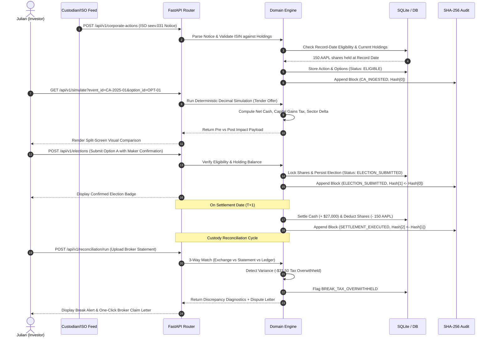
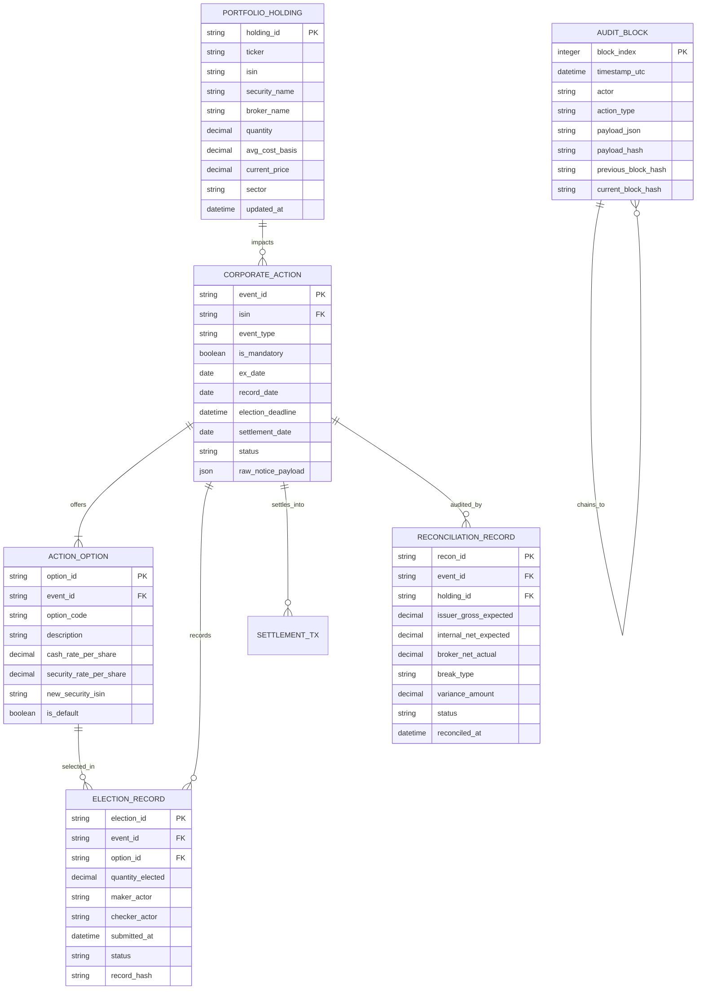

# System Architecture Specification: AURA-Wealth
## Institutional-Grade Personal Finance, Corporate Actions & Reconciliation Engine
**Document Version:** 1.0.0 (FROZEN BASELINE)  
**System Classification:** Single-Tenant Institutional Personal Wealth Prototype (Zero-Dependency Run)  
**Production Blueprint:** Enterprise-Grade Event-Driven Architecture  
**Status:** Approved & Frozen for Development  

---

## 1. Architectural Strategy & Guiding Principles

### 1.1 Karpathy's Simplicity First (Vertical Slice Delivery)
To ensure reliable, verifiable execution, **AURA-Wealth** is structured as an integrated, deterministic vertical slice:
$$\text{Data Ingestion} \longrightarrow \text{Domain Engine} \longrightarrow \text{Operator Decision} \longrightarrow \text{ACID Persistence} \longrightarrow \text{Cryptographic Audit}$$

Rather than proliferating microservices that induce network instability and deployment friction, the system is partitioned into clean, modular architectural boundaries:
- **Presentation Layer:** Responsive single-page application built on Vite + React 18 with native CSS design tokens.
- **API & Protocol Gateway:** FastAPI (Python 3.11+) providing asynchronous REST endpoints, typed Pydantic v2 serialization, and interactive OpenAPI (`/docs`).
- **Domain Calculation Engine:** Decoupled, pure-Python financial logic (`backend/app/engine/`) that enforces strict Python `Decimal` arithmetic with zero external HTTP or database dependencies.
- **Persistence & Integrity Layer:** SQLAlchemy 2.0 data repository supporting zero-configuration SQLite for local hackathon demo execution, easily reconfigured to enterprise PostgreSQL via `DATABASE_URL`.
- **Cryptographic Audit Log:** Tamper-evident `SHA-256` hash-chained event store ensuring unforgeable record keeping.

---

## 2. High-Level System Architecture Diagram

```mermaid
graph TB
    subgraph Client_Layer ["Client Presentation Layer (Vite + React 18)"]
        UI_Blotter["Corporate Action Blotter"]
        UI_Sim["What-If Impact Simulator"]
        UI_Election["Maker-Checker Election Modal"]
        UI_Recon["3-Way Reconciliation Matrix"]
        UI_Audit["Cryptographic Audit Viewer"]
    end

    subgraph API_Gateway ["API Gateway & Router (FastAPI + Pydantic v2)"]
        CORS["CORS & Security Middleware"]
        Router_CA["/api/v1/corporate-actions"]
        Router_Sim["/api/v1/simulate"]
        Router_Elect["/api/v1/elections"]
        Router_Recon["/api/v1/reconciliation"]
        Router_Audit["/api/v1/audit"]
    end

    subgraph Domain_Engine ["Deterministic Domain Engine (backend/app/engine/)"]
        ENG_Ingest["ISO 20022 Ingestion & Parser"]
        ENG_Entitle["Entitlement & Eligibility Gatekeeper"]
        ENG_Math["Portfolio Impact & What-If Calculator"]
        ENG_Advisory["Election Optimization & Scorer"]
        ENG_Settle["Settlement Lifecycle Engine"]
        ENG_Recon["3-Way Break Diagnostic Engine"]
        ENG_Hash["SHA-256 Cryptographic Hash Chainer"]
    end

    subgraph Data_Layer ["Persistence & Integrity (SQLAlchemy 2.0 / SQLite)"]
        DB_Holdings[("Holdings & Cash Balances")]
        DB_CA[("Corporate Actions & Options")]
        DB_Elections[("Election Instructions")]
        DB_Recon[("Reconciliation Ledger & Breaks")]
        DB_Audit[("Immutable Audit Block Chain")]
    end

    Client_Layer -->|HTTP/REST + JSON| API_Gateway
    API_Gateway --> Domain_Engine
    Domain_Engine --> Data_Layer
    Data_Layer --> Domain_Engine
    Domain_Engine --> API_Gateway
    API_Gateway -->|Typed Response Payloads| Client_Layer
```



---

## 3. Component Architecture & Directory Structure

The codebase is organized with separation of concerns:

```
my-finance-agent/
|-- backend/
|   |-- app/
|   |   |-- api/                      # REST API Endpoints (FastAPI Routers)
|   |   |   |-- v1/
|   |   |   |   |-- corporate_actions.py # Blotter & event ingestion
|   |   |   |   |-- simulation.py        # What-if scenario calculations
|   |   |   |   |-- elections.py         # Voluntary election execution
|   |   |   |   |-- reconciliation.py    # 3-way reconciliation & breaks
|   |   |   |   |-- audit.py             # Hash chain verification & exports
|   |   |-- engine/                   # Pure Domain Logic (Zero Web Framework Dependencies)
|   |   |   |-- __init__.py
|   |   |   |-- decimal_precision.py  # Banker's rounding & money quantizers
|   |   |   |-- ingestion.py          # ISO 20022 seev.031 parser & normalizer
|   |   |   |-- entitlement.py        # Record-date eligibility & ratio math
|   |   |   |-- simulator.py          # Pre/post portfolio what-if math
|   |   |   |-- optimizer.py          # Multi-criteria election advisor
|   |   |   |-- settlement.py         # T+1/T+2 lifecycle state transitions
|   |   |   |-- reconciliation.py     # 3-way matching & break diagnostics
|   |   |   |-- audit_chainer.py      # SHA-256 block hashing & verification
|   |   |-- models/                   # SQLAlchemy 2.0 Relational Entities
|   |   |   |-- base.py
|   |   |   |-- portfolio.py          # PortfolioHolding, CashBalance
|   |   |   |-- corporate_action.py   # CorporateAction, ActionOption
|   |   |   |-- election.py           # ElectionRecord, MakerCheckerLog
|   |   |   |-- reconciliation.py     # ReconciliationRecord, DiscrepancyBreak
|   |   |   |-- audit_block.py        # AuditBlock
|   |   |-- schemas/                  # Pydantic v2 Input/Output Validation
|   |   |   |-- corporate_action.py
|   |   |   |-- simulation.py
|   |   |   |-- election.py
|   |   |   |-- reconciliation.py
|   |   |   |-- audit.py
|   |   |-- db/                       # Database Session & Migrations
|   |   |   |-- session.py            # SQLite/PostgreSQL engine connection
|   |   |   |-- seed.py               # Seed fixtures (AAPL, MSFT, NVDA events)
|   |   |-- main.py                   # FastAPI Application Root
|   |-- tests/                        # Comprehensive Pytest Test Suites
|   |   |-- test_precision_math.py    # Zero float leak verification
|   |   |-- test_simulation.py        # What-if impact calculations
|   |   |-- test_election_maker.py    # Maker-Checker safety assertions
|   |   |-- test_reconciliation.py    # 3-way break detection tests
|   |   |-- test_audit_hash.py        # Cryptographic chain integrity tests
|   |-- requirements.txt              # Pinned Minimal Python Dependencies
|-- frontend/
|   |-- src/
|   |   |-- components/
|   |   |   |-- Header.jsx            # Terminal title, portfolio net worth
|   |   |   |-- ActionBlotter.jsx     # High-density corporate action table
|   |   |   |-- ImpactSimulatorModal.jsx # Split-screen what-if simulator
|   |   |   |-- MakerCheckerSlider.jsx# Confirmation slider component
|   |   |   |-- ReconciliationView.jsx# 3-way reconciliation matrix & break view
|   |   |   |-- DisputeLetterModal.jsx# One-click broker dispute letter
|   |   |   |-- AuditTrailViewer.jsx  # SHA-256 cryptographic chain inspector
|   |   |-- services/
|   |   |   |-- api.js                # Fetch/Axios client pointing to /api/v1
|   |   |-- styles/
|   |   |   |-- index.css             # Obsidian & Emerald design tokens
|   |   |-- App.jsx                   # Master dashboard state container
|   |   |-- main.jsx
|   |-- index.html
|   |-- vite.config.js
|   |-- package.json
|-- docs/
|   |-- API_CONTRACT_V1.md            # Frozen OpenAPI / JSON Schema Contract
|-- PRD.md
|-- Design-System.md
|-- Architecture.md
|-- AGENTS.md
```

---

## 4. End-to-End Corporate Action Lifecycle Flow



---

## 5. Deterministic Decimal Precision Policy

Financial computation in personal wealth cannot tolerate IEEE 754 floating-point drift. A rounding error of $\$0.0001$ compounded across corporate splits and tax-lot basis calculations violates institutional accounting standards and induces cumulative balance breaks.

### 5.1 Python `Decimal` Policy Implementation
1. **Zero Float Construction:**
   - Float arguments are forbidden in `Decimal()` constructors. All numeric data must be parsed directly from strings:
     ```python
     # FORBIDDEN (Float Leak Hazard):
     price = Decimal(180.25)  # Results in Decimal('180.25000000000000568434...')

     # MANDATORY (Zero-Float Guarantee):
     price = Decimal("180.25")
     ```
2. **Standard Quantization & Banker's Rounding:**
   - Monetary Currency: `Decimal("0.01")` using `ROUND_HALF_EVEN`.
   - Security Share Quantities: `Decimal("0.0001")` (accommodating fractional shares).
   - Exchange-Mandated Fractional Share Liquidation:
     - For reverse splits or spin-offs where brokers cannot credit fractional shares, the engine applies `ROUND_DOWN` to integer units and computes Cash-in-Lieu (CIL) for the residual fraction:
       $$\text{Allocated Shares} = \lfloor \text{Raw Entitlement} \rfloor$$
       $$\text{Cash-in-Lieu} = (\text{Raw Entitlement} - \text{Allocated Shares}) \times \text{Liquidation Price}$$

---

## 6. Relational Database Schema & Data Models

### 6.1 Entity Relationship Diagram



---

## 7. Cryptographic Tamper-Evident Audit Architecture

To provide enterprise-grade auditability, AURA-Wealth implements an unforgeable, in-database append-only blockchain ledger.

### 7.1 Hash Chaining Algorithm
For each new audit event $i$, the block hash $H_i$ is computed deterministically:
$$H_0 = \text{SHA256}(\text{"GENESIS_BLOCK_AURA_WEALTH_2025"})$$
$$H_i = \text{SHA256}\Big(H_{i-1} \parallel \text{Timestamp}_{\text{UTC}} \parallel \text{Actor} \parallel \text{ActionType} \parallel \text{SHA256}(\text{Payload}_{\text{JSON}})\Big)$$

```python
import hashlib
import json
from datetime import datetime

def compute_audit_hash(prev_hash: str, timestamp_utc: str, actor: str, action_type: str, payload: dict) -> str:
    payload_serialized = json.dumps(payload, sort_keys=True)
    payload_hash = hashlib.sha256(payload_serialized.encode("utf-8")).hexdigest()
    
    header = f"{prev_hash}|{timestamp_utc}|{actor}|{action_type}|{payload_hash}"
    return hashlib.sha256(header.encode("utf-8")).hexdigest()
```

### 7.2 Tamper Verification Routine
Upon system startup or whenever the user clicks **"Verify Audit Chain"** on the dashboard, the backend traverses all audit records sequentially:
1. Re-computes $H_i'$ from $H_{i-1}$, timestamp, actor, and payload.
2. Checks if $H_i' == H_i$.
3. If any discrepancy is found, an immediate `SECURITY_ALERT_AUDIT_TAMPERED` status is triggered, identifying the exact block index modified.

---

## 8. Enterprise Scalability & Production Blueprint

While this vertical slice is optimized for zero-dependency execution on local SQLite and single-process FastAPI, the architecture is designed to scale horizontally to institutional tier-1 deployment:

1. **Message Ingestion Decoupling:**
   - In production, replace REST ingestion with an **Apache Kafka** cluster subscribed to SWIFT ISO 20022 message queues (`seev.031`, `seev.035`, `seev.039`) with distributed consumers.
2. **Distributed Persistence & Sharding:**
   - Migrate SQLite to **PostgreSQL 16** with read replicas.
   - Partition tables by `tenant_id` and `user_id` for multi-family office multi-tenancy.
3. **Async Calculation Workers:**
   - Complex portfolio Monte-Carlo simulations and tax-lot FIFO reallocations offloaded to **Celery / Redis** worker pools.
4. **Hardware Security Module (HSM) Signing:**
   - The SHA-256 audit chainer upgrades to asymmetric ECDSA / Ed25519 digital signatures backed by an AWS CloudHSM or HashiCorp Vault.
